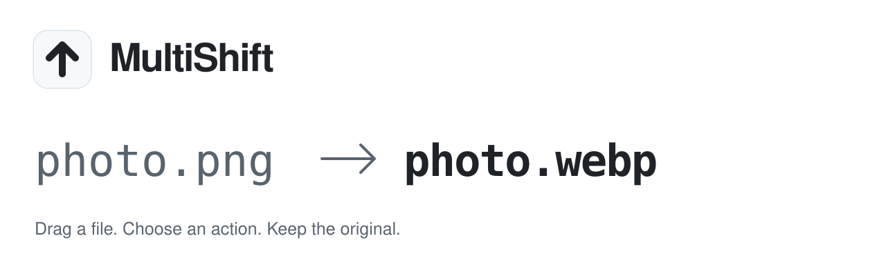
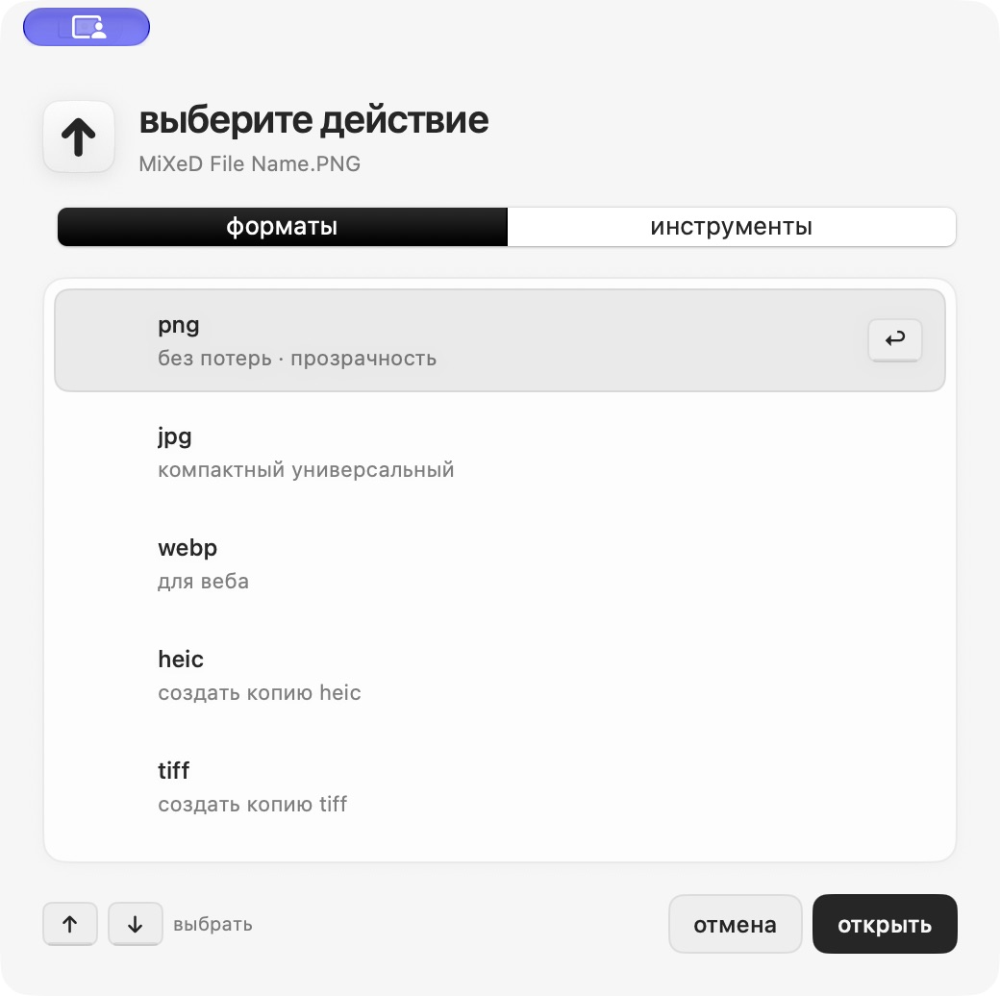

<p align="right"><a href="README.md">Русский</a> · <b>English</b></p>

<picture>
  <source media="(prefers-color-scheme: dark)" srcset=".github/assets/header-dark.en.svg">
  <source media="(prefers-color-scheme: light)" srcset=".github/assets/header-light.en.svg">
  
</picture>

<p align="center">
  <a href="https://github.com/SokolovMO/MultiShift/actions/workflows/macos.yml"></a>
  
  
</p>

<p align="center">
  <b><a href="https://sokolovmo.ru/multishift/">Download for macOS</a></b> &nbsp;·&nbsp;
  <a href="#install">Install</a> &nbsp;·&nbsp;
  <a href="SUPPORT.en.md">Get help</a> &nbsp;·&nbsp;
  <a href="https://github.com/SokolovMO/MultiShift/issues/new/choose">Report a bug</a>
</p>

## Drag a file. Edit a copy.

MultiShift is a native macOS app for conversion and editing right from Finder.
Start dragging, press Shift or your configured key, and drop onto an action in the wheel.
The result is a new copy; your original stays where it was.

- **Images.** Convert, resize, crop, reflect, annotate, redact, remove metadata,
  and compress toward a size limit. Preview before saving.
- **Documents.** PDF, Word, Markdown, HTML, spreadsheets, presentations, ebooks,
  SVG, and subtitles. Choose the order before combining files.
- **Audio and video.** Convert, extract audio, trim, adjust speed and volume,
  compress, and edit metadata. FFmpeg is included in the distributed app.
- **Archives.** Create ZIP/TAR.GZ copies from files and folders.
- **Daily workflow.** Batch jobs, history, output folder settings, native result
  notifications, Finder actions, and undo through the Trash.
- **Native interface.** SwiftUI/AppKit, English and Russian, light and dark appearances.

Actions depend on input format. Legacy DOC/XLS/PPT routes require a separately installed
LibreOffice. Complex document conversions can need manual corrections; scanned PDF OCR
is not included. [Feature scope and verification](docs/NATIVE-FEATURES-2026-11-12.md).

<picture>
  <source media="(prefers-color-scheme: dark)" srcset=".github/assets/screenshot-dark.png">
  <source media="(prefers-color-scheme: light)" srcset=".github/assets/screenshot-light.png">
  
</picture>

<sub>Real interface capture from project validation. Individual controls may differ in newer builds; the capture follows your selected theme.</sub>

## Install

**Requires macOS 14+ and an Apple Silicon Mac.** Intel releases are not provided here.

### Download the app

1. Get the DMG from the [official download page](https://sokolovmo.ru/multishift/)
   or [GitHub Releases](https://github.com/SokolovMO/MultiShift/releases/latest).
2. Move **MultiShift** to **Applications** and open it.
3. Start dragging a file and press Shift; configure a different key in settings if preferred.

> [!IMPORTANT]
> This is an early, independently distributed 0.x app. It is **ad-hoc signed** and
> **not notarized by Apple**. macOS may require allowing the first launch in
> System Settings → Privacy & Security.

### Homebrew

```sh
brew tap SokolovMO/apps
HOMEBREW_MULTI_APPS_ALLOW_UNNOTARIZED=1 brew install --cask SokolovMO/apps/multishift
```

The environment variable explicitly opts into installing this unnotarized build.
Read the [distribution guide](docs/DISTRIBUTION.md) for verification and installation details.

Updates are available through Sparkle with confirmation before installation.
[Distribution and delta-patch details](docs/DISTRIBUTION.md).

## Your files stay on your Mac

Conversion requires no account or cloud upload. Operation history and preferences are local.
MultiShift reads drag/shortcut state to show the action wheel and can request notification permission.

Update checks contact the release server. Choosing to open an image location sends coordinates
to OpenStreetMap in your browser. Keep private file names, documents, and raw logs out of public
reports. Read [Privacy](docs/PRIVACY.md) and [Security](SECURITY.en.md).

## Build from source

Use macOS 14+, Xcode with the macOS SDK, and Python 3.12. This repository maintains the native
macOS release; inherited Windows/Linux sources are not platform support commitments.

```sh
git clone --depth 1 https://github.com/SokolovMO/MultiShift.git
cd MultiShift
python3.12 -m venv .venv
source .venv/bin/activate
python -m pip install -r requirements-macos.lock -r requirements.txt
QT_QPA_PLATFORM=offscreen python -m pytest -q
swift test --package-path macos
bash scripts/build_macos.sh
```

The app is written to `dist/MultiShift.app`. No server access or publisher's signing key is needed;
update checking is disabled by default in development builds.
[Architecture](docs/ARCHITECTURE.md) · [Distribution](docs/DISTRIBUTION.md)

## Contribute

[Report a bug](https://github.com/SokolovMO/MultiShift/issues/new?template=bug_report.yml),
[suggest a feature](https://github.com/SokolovMO/MultiShift/issues/new?template=feature_request.yml),
or read [Contributing](CONTRIBUTING.en.md) before sending a pull request.
English and Russian are welcome. Use synthetic examples and remove private data from captures
and logs. [Help](SUPPORT.en.md) · [Code of conduct](CODE_OF_CONDUCT.en.md)

Security concerns belong in [private vulnerability reports](https://github.com/SokolovMO/MultiShift/security/advisories/new),
not public issues. See the [security policy](SECURITY.en.md).

## Other apps

[**MultiSwitcher**](https://github.com/SokolovMO/MultiSwitcher) — a native macOS menu-bar app
for Russian/English layout switching, text correction, and per-app rules.

## License

[GNU AGPL v3](LICENSE). [Third-party notices](THIRD-PARTY-NOTICES.md).

Maintained by [SokolovMO](https://github.com/SokolovMO).
