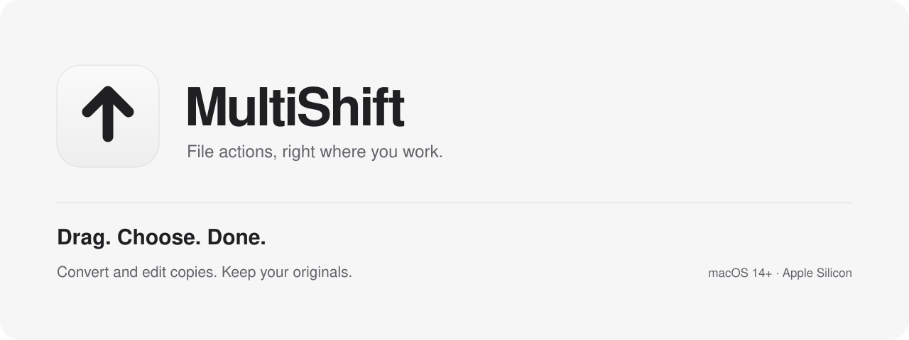
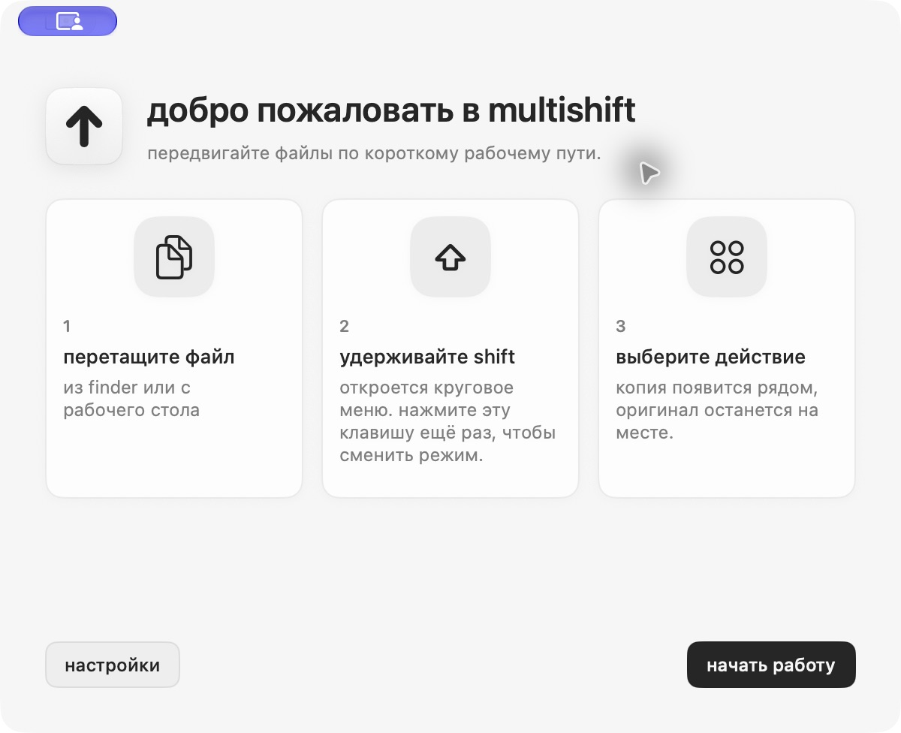
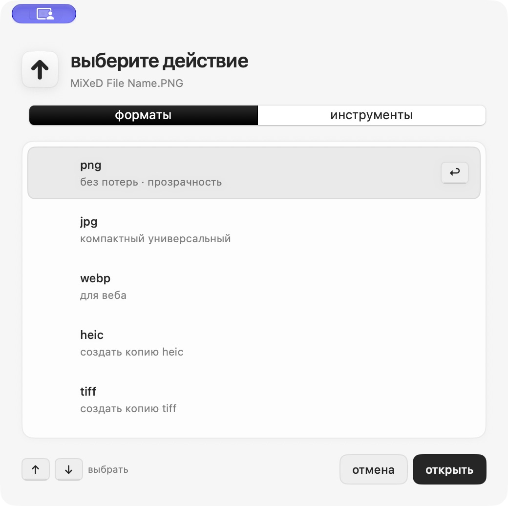

<p align="center">
  
</p>

<p align="center">
  <a href="https://sokolovmo.ru/multishift/"><strong>Download for macOS</strong></a> ·
  <a href="#how-it-works">How it works</a> ·
  <a href="docs/DISTRIBUTION.md">Build &amp; release</a> ·
  <a href="docs/README.ru.md">Русский</a>
</p>

<p align="center">
  <a href="https://github.com/SokolovMO/MultiShift/actions/workflows/macos.yml"></a>
  <a href="LICENSE"></a>
  
  
</p>

MultiShift puts conversion and editing one gesture away in Finder. Start dragging a file,
press your chosen shortcut, and drop it onto an action. The result is a new copy;
your original stays where it was.

A native SwiftUI/AppKit interface, a local Python conversion engine, and a small menu bar
companion. English and Russian, light and dark appearances, batch jobs, and operation history.

## How it works

1. **Drag** a file or a selection from Finder.
2. **Press Shift** (or your configured key) to open the action wheel.
3. **Drop** onto a format or tool. Review, edit, or save the resulting copy.

Open the result, reveal it in Finder, or undo a completed operation by moving its output
to the Trash. A missing output produces an explanation instead of a silent Open button.

<details>
<summary><strong>See the interface</strong></summary>

Project screenshots illustrating the workflow; individual controls may differ in newer builds.

<picture>
  <source media="(prefers-color-scheme: dark)" srcset="docs/screenshots/onboarding-dark.png">
  
</picture>

<picture>
  <source media="(prefers-color-scheme: dark)" srcset="docs/screenshots/chooser-dark.png">
  
</picture>
</details>

## What you can do

- **Images:** convert formats; resize, crop, rotate, reflect, annotate, redact, remove metadata,
  and compress toward a size limit. Preview edits before saving.
- **PDFs and documents:** combine files in a chosen order; work with PDF, Word, Markdown,
  HTML, spreadsheets, presentations, ebooks, SVG, and subtitles. Routes depend on the input format.
- **Audio and video:** convert, extract audio, trim, compress, adjust speed or volume,
  and edit metadata. FFmpeg is included in the distributed app.
- **Archives:** package files and folders as ZIP or TAR.GZ copies.
- **Everyday workflow:** batch processing, history, custom output locations, native result
  notifications, Finder actions, and safe undo of generated files.

Legacy DOC/XLS/PPT routes require a separately installed LibreOffice. Complex document
conversions can need manual corrections; scanned PDF OCR is not included.
See [feature and verification notes](docs/NATIVE-FEATURES-2026-11-12.md).

## Install

**macOS 14 or later · Apple Silicon**

[Download the DMG](https://sokolovmo.ru/multishift/) and drag MultiShift to Applications.
The app is currently **ad-hoc signed and not notarized by Apple**. macOS may require an
explicit opening approval in System Settings → Privacy & Security. This is an early 0.x release.

Prefer Homebrew?

```sh
brew tap SokolovMO/apps
HOMEBREW_MULTI_APPS_ALLOW_UNNOTARIZED=1 brew install --cask SokolovMO/apps/multishift
```

The opt-in permits installation of this unnotarized app. See the
[distribution guide](docs/DISTRIBUTION.md) for verification and installation details.

### Small updates

Sparkle checks for updates and asks before installing. Matching versions download a signed
**delta patch**, with the full archive available as a recovery fallback. For **0.4.0 → 0.4.1**,
the patch is **183 KiB**, compared with a **124 MiB** full ZIP. Future patch sizes depend on
what changes. First installations and Homebrew upgrades use the full package.

The feed, archives, and patches use Ed25519 signatures. This update signing is separate
from Apple notarization. [How delta updates are verified](docs/DELTA-UPDATES-2026-11-13.md).

## Privacy and permissions

File processing runs on your Mac. No conversion account or cloud upload is required.
MultiShift monitors drag/shortcut state to display its action wheel and can request notification
permission. Update checks contact the configured release server; opening a location in a map
opens OpenStreetMap in your browser. Keep private file names out of public bug reports.

Read the [privacy notes](docs/PRIVACY.md) and [security policy](SECURITY.md).

## Build from source

Use macOS 14+, Xcode with the macOS SDK, and Python 3.12. This repository contains the native
macOS app plus its inherited Python engine; Windows and Linux releases are not maintained here.

```sh
git clone --depth 1 https://github.com/SokolovMO/MultiShift.git
cd MultiShift
python3.12 -m venv .venv
source .venv/bin/activate
python -m pip install -r requirements-macos.lock -r requirements.txt
QT_QPA_PLATFORM=offscreen python -m pytest -q
swift test --package-path macos
bash scripts/build_macos.sh
```

The local app is written to `dist/MultiShift.app`; update checking is disabled by default for
independent development builds. No release signing key or server access is needed.

- [Contributing and checks](CONTRIBUTING.md)
- [Architecture](docs/ARCHITECTURE.md)
- [Release and delta-update workflow](docs/DISTRIBUTION.md)
- [Changes](CHANGELOG.md)
- [Report a bug or suggest a feature](https://github.com/SokolovMO/MultiShift/issues/new/choose)

## Credits and license

MultiShift is a macOS-focused derivative of [DragShift](https://github.com/llamaboi55/DragShift)
by its contributors. The original project and adapted contributions retain their MIT notices.
MultiShift adds the native macOS shell, Finder workflow, result notifications, history,
editing tools, and independently hosted signed updates.

The combined MultiShift project is distributed under [GNU AGPL v3](LICENSE), including its
AGPL PDF dependencies. See [third-party notices](THIRD-PARTY-NOTICES.md) for component licenses
and contribution provenance. Maintained by [SokolovMO](https://github.com/SokolovMO).
