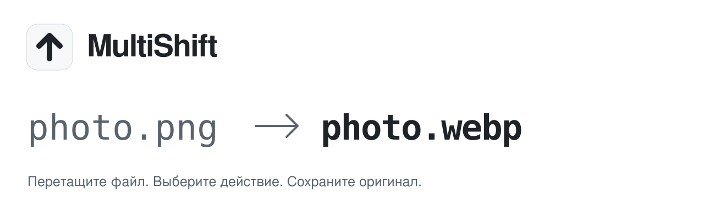

<p align="right"><b>Русский</b> · <a href="README.en.md">English</a></p>

<picture>
  <source media="(prefers-color-scheme: dark)" srcset=".github/assets/header-dark.svg">
  <source media="(prefers-color-scheme: light)" srcset=".github/assets/header-light.svg">
  
</picture>

<p align="center">
  <a href="https://github.com/SokolovMO/MultiShift/actions/workflows/macos.yml"></a>
  
  
  <a href="LICENSE"></a>
</p>

<p align="center">
  <b><a href="https://sokolovmo.ru/multishift/">Скачать для macOS</a></b> &nbsp;·&nbsp;
  <a href="#установка">Установка</a> &nbsp;·&nbsp;
  <a href="SUPPORT.md">Помощь</a> &nbsp;·&nbsp;
  <a href="https://github.com/SokolovMO/MultiShift/issues/new/choose">Сообщить об ошибке</a>
</p>

## Перетащите файл. Обработайте копию.

MultiShift — нативное macOS-приложение для конвертации и обработки файлов прямо из Finder.
Начните перетаскивание, нажмите Shift или выбранную клавишу и отпустите файл на действии
в круговом меню. Результат сохраняется как копия, оригинал остаётся на месте.

- **Изображения.** Форматы, размер, обрезка, отражение, разметка, скрытие областей,
  удаление метаданных и сжатие до лимита с предпросмотром.
- **Документы.** PDF, Word, Markdown, HTML, таблицы, презентации, электронные книги,
  SVG и субтитры. Объединение файлов с выбором порядка.
- **Аудио и видео.** Конвертация, извлечение звука, обрезка, скорость, громкость,
  сжатие и метаданные. FFmpeg включён в приложение.
- **Архивы.** Создание ZIP/TAR.GZ из файлов и папок.
- **Рабочий процесс.** Пакетные задачи, история, папка результатов, системные уведомления,
  открытие результата в Finder и отмена через Корзину.
- **Нативный интерфейс.** SwiftUI/AppKit, русский и английский, светлая и тёмная темы.

Доступные действия зависят от формата. Старые DOC/XLS/PPT требуют LibreOffice отдельно;
сложные преобразования документов могут требовать ручной правки. OCR сканированных PDF
не включён. [Возможности и границы проверки](docs/NATIVE-FEATURES-2026-11-12.md).

<picture>
  <source media="(prefers-color-scheme: dark)" srcset=".github/assets/screenshot-dark.png">
  <source media="(prefers-color-scheme: light)" srcset=".github/assets/screenshot-light.png">
  
</picture>

<sub>Реальный снимок интерфейса из проверки проекта. Отдельные элементы в новых сборках могут отличаться; снимок следует выбранной теме.</sub>

## Установка

**Нужны macOS 14+ и Mac с Apple Silicon.** Выпуски для Intel здесь не предоставляются.

### Скачать приложение

1. Скачайте DMG с [официальной страницы](https://sokolovmo.ru/multishift/)
   или из [GitHub Releases](https://github.com/SokolovMO/MultiShift/releases/latest).
2. Перенесите **MultiShift** в **«Программы»** и откройте.
3. Начните перетаскивать файл и нажмите Shift; клавишу можно изменить в настройках.

> [!IMPORTANT]
> Это ранняя версия 0.x с независимой раздачей. Приложение подписано **ad-hoc** и пока
> **без нотарификации Apple**. macOS может потребовать разрешить первый запуск в
> «Системных настройках → Конфиденциальность и безопасность».

### Homebrew

```sh
brew tap SokolovMO/apps
HOMEBREW_MULTI_APPS_ALLOW_UNNOTARIZED=1 brew install --cask SokolovMO/apps/multishift
```

Переменная явно разрешает установку этой ненотарифицированной сборки. Подробности
проверки подписи, установки и обновления — в [инструкции по раздаче](docs/DISTRIBUTION.md).

## Обновления

Sparkle проверяет обновления и запрашивает подтверждение установки. Для подходящей
исходной версии скачивается подписанная **дельта**, полный архив остаётся резервом
при отсутствии подходящей базы или ошибке применения.

Переход **0.4.0 → 0.4.1**: **183 КиБ** вместо **124 МиБ** полного ZIP.
Размер будущих дельт зависит от изменений. Первая установка и Homebrew используют полный пакет.
Лента, архивы и патчи подписаны Ed25519; это отдельный механизм от нотарификации Apple.

[История изменений](CHANGELOG.md) · [Проверка дельты](docs/DELTA-UPDATES-2026-11-13.md)

## Файлы обрабатываются на вашем Mac

Для конвертации не нужны аккаунт или облачная загрузка. История операций и настройки
хранятся локально. MultiShift отслеживает состояние перетаскивания и клавиши для меню,
может запросить разрешение на системные уведомления.

Проверка обновлений обращается к серверу раздачи. Открытие геометки передаёт координаты
OpenStreetMap через браузер. Не публикуйте личные имена файлов, документы и необработанные
журналы в Issues. [Приватность](docs/PRIVACY.md) · [Безопасность](SECURITY.md)

## Сборка из исходников

Нужны macOS 14+, Xcode с macOS SDK и Python 3.12. Здесь поддерживается нативный выпуск
macOS; унаследованные исходники Windows/Linux не означают поддержку этих платформ.

```sh
git clone --depth 1 https://github.com/SokolovMO/MultiShift.git
cd MultiShift
python3.12 -m venv .venv
source .venv/bin/activate
python -m pip install -r requirements-macos.lock -r requirements.txt
QT_QPA_PLATFORM=offscreen python -m pytest -q
swift test --package-path macos
bash scripts/build_macos.sh
```

Приложение появится в `dist/MultiShift.app`. Для локальной сборки не нужны серверные
доступы или ключ обновлений; обновления по умолчанию отключены в сборке для разработки.
[Архитектура](docs/ARCHITECTURE.md) · [Публикация](docs/DISTRIBUTION.md)

## Участие

[Сообщите об ошибке](https://github.com/SokolovMO/MultiShift/issues/new?template=bug_report.yml),
[предложите возможность](https://github.com/SokolovMO/MultiShift/issues/new?template=feature_request.yml)
или прочитайте [правила участия](CONTRIBUTING.md) перед отправкой PR.
Принимаем русский и английский. Используйте синтетические примеры и удаляйте личные
данные из снимков и журналов. [Помощь](SUPPORT.md) · [Правила общения](CODE_OF_CONDUCT.md)

Уязвимости направляйте через [приватный отчёт](https://github.com/SokolovMO/MultiShift/security/advisories/new),
а не в публичный Issue. Подробнее — [политика безопасности](SECURITY.md).

## Другие приложения

[**MultiSwitcher**](https://github.com/SokolovMO/MultiSwitcher) — переключение русской
и английской раскладки, исправление текста и правила для приложений в меню macOS.

## Лицензия и авторство

MultiShift основан на [DragShift](https://github.com/llamaboi55/DragShift).
Авторство и MIT-уведомления исходного проекта и адаптированных вкладов сохранены.
Объединённый MultiShift распространяется под [GNU AGPL v3](LICENSE), в том числе
из-за используемых PDF-компонентов. [Сторонние компоненты](THIRD-PARTY-NOTICES.md)
сохраняют свои лицензии. Это отдельный macOS-проект, а не официальный выпуск DragShift.

Разработчик и сопровождающий — [SokolovMO](https://github.com/SokolovMO).
