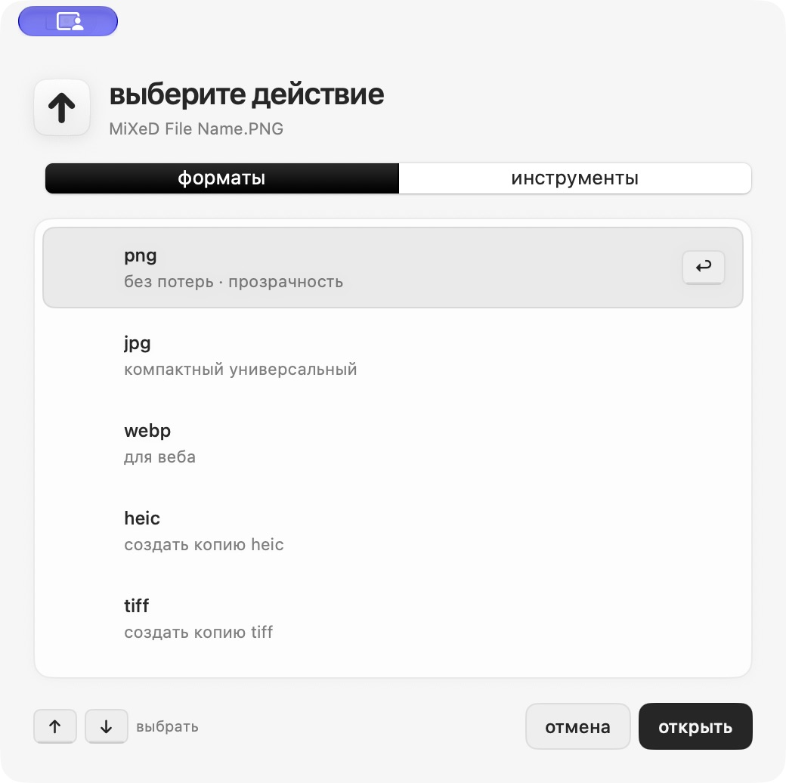

# MultiShift

**Конвертация и обработка копий файлов прямо из Finder.**

[Скачать для macOS](https://sokolovmo.ru/multishift/) · [English](../README.md) ·
[История изменений](../CHANGELOG.md) · [Сообщить об ошибке](https://github.com/SokolovMO/MultiShift/issues/new/choose)

Начните перетаскивать файл, нажмите Shift или выбранную клавишу, отпустите файл
на действии в круговом меню. Результат сохраняется как копия, оригинал остаётся на месте.



## Возможности

- Изображения: форматы, размер, обрезка, отражение, разметка, скрытие областей,
  удаление метаданных и сжатие до лимита с предпросмотром.
- Документы: PDF, Word, Markdown, HTML, таблицы, презентации, электронные книги,
  SVG и субтитры. Доступные действия зависят от исходного формата.
- Аудио/видео: конвертация, извлечение звука, обрезка, скорость, громкость,
  сжатие и метаданные. FFmpeg включён в приложение.
- Архивы: копии файлов и папок в ZIP/TAR.GZ.
- Пакетная обработка, история, папка результатов, системные уведомления,
  открытие результата и Finder, отмена через Корзину.
- Нативный интерфейс SwiftUI/AppKit, русский/английский, светлая/тёмная темы.

Старые DOC/XLS/PPT требуют LibreOffice отдельно. Сложные преобразования документов
могут требовать ручной правки. OCR сканированных PDF не включён.

## Установка и обновления

Нужны **macOS 14+ и Apple Silicon**. Скачайте DMG и перенесите MultiShift в «Программы».
Приложение подписано ad-hoc и пока без нотарификации Apple; macOS может потребовать
разрешить открытие в «Системных настройках → Конфиденциальность и безопасность».
Это ранняя версия 0.x.

```sh
brew tap SokolovMO/apps
HOMEBREW_MULTI_APPS_ALLOW_UNNOTARIZED=1 brew install --cask SokolovMO/apps/multishift
```

Sparkle предлагает обновления с подтверждением. Для подходящей исходной версии
скачивается подписанная дельта: переход 0.4.0 → 0.4.1 занимает 183 КиБ вместо
124 МиБ полного ZIP. Полный архив остаётся резервом и нужен при первой установке.
Размер будущих дельт зависит от изменений. Homebrew скачивает полный пакет.

Файлы обрабатываются локально. Обновления обращаются к серверу раздачи; открытие
геометки передаёт координаты OpenStreetMap через браузер. Разрешение уведомлений
управляется macOS. [Подробнее о приватности](PRIVACY.md).

## Для разработчиков

[Сборка и тесты](../CONTRIBUTING.md) · [Архитектура](ARCHITECTURE.md) ·
[Публикация](DISTRIBUTION.md) · [Правила проекта](../AGENTS.md)

Исходники Windows/Linux унаследованы от DragShift, но здесь поддерживается выпуск macOS.
Ключи обновлений и доступ к серверу не нужны для локальной сборки.

MultiShift основан на [DragShift](https://github.com/llamaboi55/DragShift).
Уведомления об авторстве и MIT-лицензии исходного проекта сохранены.
Объединённый проект распространяется под [GNU AGPL v3](../LICENSE);
[сторонние компоненты и их лицензии](../THIRD-PARTY-NOTICES.md).
