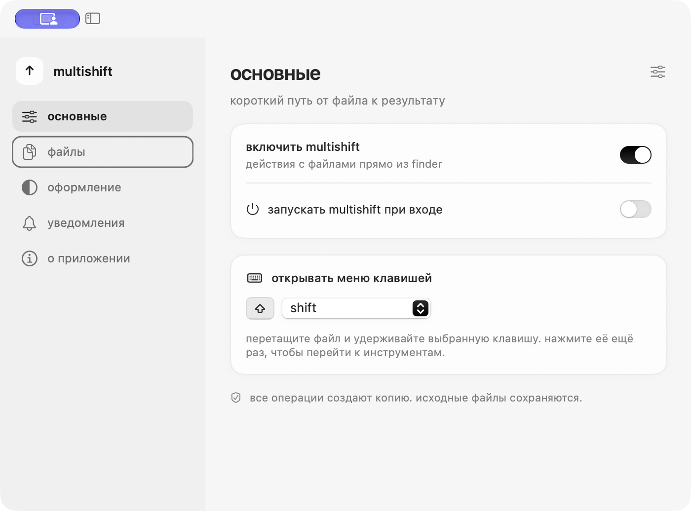
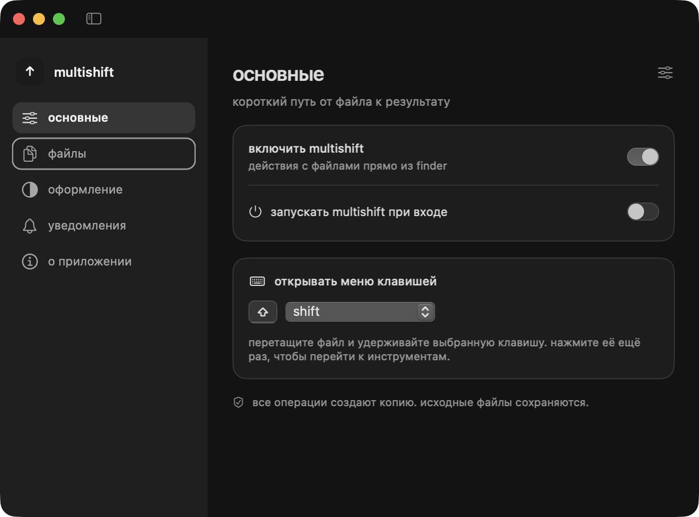

# Native settings and tray — 2026-10-24

## Changes

- Both status-item clicks use NSMenu and the existing recent-operations submenus.
- Custom popover construction, timed height changes and fade layers are removed from the operational path.
- Menus rebuild at the opening boundary. Model updates refresh existing item availability without reordering tracked items.
- Details, Finder and undo remain attached to stable operation UUIDs.
- MultiDesignKit stays byte-identical to the companion application; conversion engines are unchanged.

## Validation

SwiftPM: 20 tests passed. Python: 46 passed, 2 skipped (five existing SWIG deprecation warnings). Native self-test passed. UI probe: 60 states (five sections, both themes, widths and sidebar states); geometry, restoration, navigation, keyboard and Reduce Motion passed. Native menu fixtures cover empty history and 20 operations with long mixed-case names; both themes pass in-place state updates, stable item identity, valid UUIDs and disabling stale operations. These are structural runtime checks, not a physical pointer traversal test.

Both release apps built successfully. Strict deep code-signature verification passed for the bundles, extracted ZIPs and installed copies. Installed executables match their extracted ZIP counterparts. Both apps launched normally through Launch Services and are running from /Applications. MultiShift uses a local ad-hoc signature; notarization was not performed.

Menu fixtures use synthetic records in isolated review storage. Personal operation history, profiles, backups and UserDefaults are not included in Git or distributable ZIPs.

## Remaining manual acceptance

VoiceOver speech, physical left/right tray clicks, fast pointer movement through native submenus and the subjective smoothness of a completing operation during menu tracking have not been certified. The computer-control service repeatedly stalled; no synthetic menu screenshot is presented as evidence of actual menu tracking. Accessibility structure and automated keyboard checks do not establish VoiceOver speech behavior.

## Artifact hashes

- MultiSwitcher-native-settings.zip: `8040f57318025ffcaea765d6aa4ceea710af47cebb3f2181b6372aaa4b5667d5`
- MultiShift-native-tray.zip: `db0dffcfd1075b06dab1f09ad6ed1971252085790a8e5c9050b687d1719092f2`

ZIPs are local build artifacts, intentionally excluded from source control. See adjacent JSON reports for measured runtime checks.

## Real application captures

