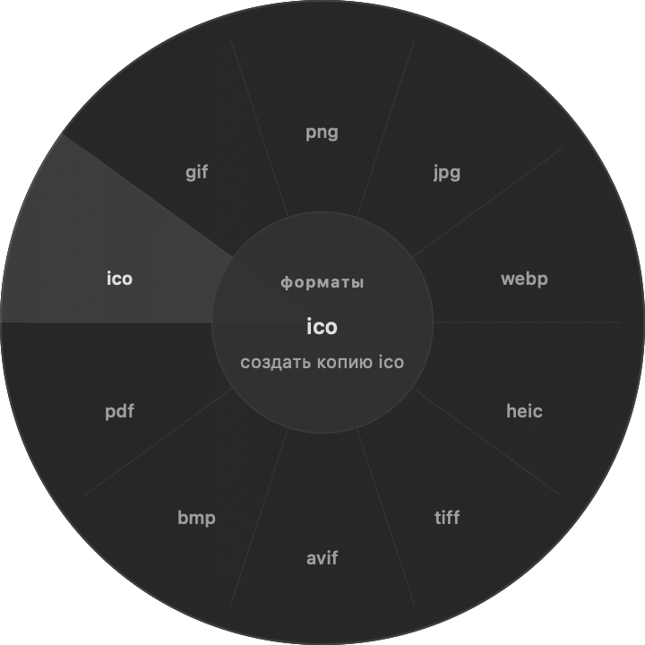
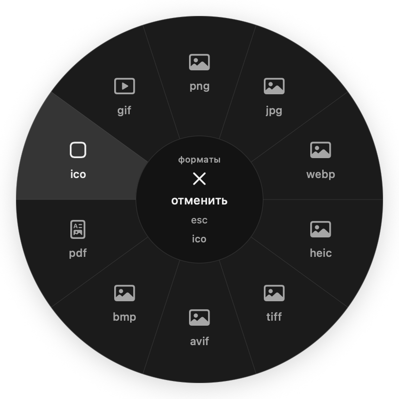
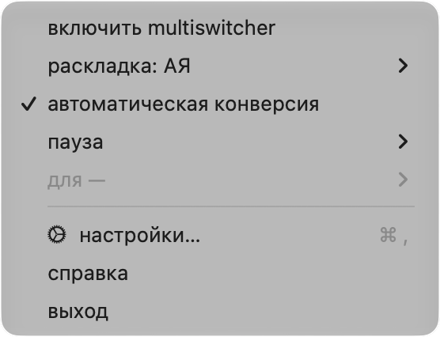

# MultiShift / MultiSwitcher — итоговый UI и functional audit

25 октября 2026 · macOS 27.0.1 · Apple M4 · arm64 · один физический 2x display.

## Итог

Основные кодовые исправления реализованы, автоматические и native fixture проверки пройдены. Этап по полному плану ещё не принят: U01–U09 ниже содержат конкретные оставшиеся проверки/дефекты. Непроведённая проверка не считается PASS.

Preview-сборки установлены в /Applications после аудита; подписи и launch проверены. Временные сборки очищены. Пользовательские profile/history snapshots, точные разрешения и machine-specific profiler trace исключены из Git.

## Архитектура и baseline

MultiSwitcher: SwiftPM, AppKit controllers, отдельный MultiSwitcherCore (policy, mapping, dictionaries, profile, learning), CGEvent tap и AX text replacement. MultiShift: SwiftUI внутри AppKit windows/panels; native AppModel/FileJobCoordinator → packaged Python JSON worker. Его SwiftPM package тестирует Core, основная app компилируется явным swiftc списком.

Общие источники vendored, сборки независимы. MultiDesignKit, MultiPopoverKit, metrics и audit environment побайтово совпадают. Architecture-inventory.json содержит полный список текущих Swift sources/imports/types/hash. Новых sibling runtime dependencies нет.

Исходные HEAD: MultiSwitcher 83de261; MultiShift 41a8ed9, оба checkout уже имели незакоммиченные изменения. Их исходные diff и hashes в baseline.json / baseline/*.patch. Девять конфликтных копий сохранены в source-conflicts, а не удалены безвозвратно. Словари и Python conversion logic не редактировались.

## Исправления

- R01 HIGH: нарисованные и активные сектора расходились на половину сектора; исправлено единым WheelGeometry.
- R02 HIGH: часть видимого cancel-центра могла выбрать формат; весь r=64 pt теперь отменяет.
- R03 HIGH: край экрана и release могли исполнить прежний/неосознанный выбор; добавлены 6 pt arming и final-position hit-test.
- R04 MEDIUM: early close пересоздавал fully-visible view; уходящий view теперь сохраняет presentation, новый gesture получает другой объект.
- R05 HIGH: keyboard/direct learning navigation могла проиграть старому fade completion; все requests инвалидируют предыдущий переход.
- R06 MEDIUM: обычный status menu MultiSwitcher рисовался custom popover; shipping status item теперь использует NSMenu.
- R07 MEDIUM: repeat debug timer просыпался при пустой очереди; заменён одноразовым flush с cancel/release.
- R08 MEDIUM: прежний format SF Symbol не отображался; заменён доступными системными символами, все проверены в native window.
- R09 HIGH: малые light-circle подписи имели недостаточный контраст; финальная поверхность и текст используют opaque shared tokens.
- R10 HIGH: onboarding включал autoConvert, оставляя открытый checkbox выключенным; воспроизведено CUA, исправлено и проверено реальным controller probe.
- R11 MEDIUM: Reduce Motion не останавливал уже начатую sidebar-анимацию; добавлен немедленный путь и regression.
- R12 HIGH: audit мог писать diagnostic/frame/updater/consent данные в рабочие места; новые пути изолированы, неверный относительный root завершается до открытия production storage.
- R13 MEDIUM: QA restore использовал глобальные NSWindow audit keys и фиксированное ожидание; новый roundtrip fixture изолирован, probe ждёт фактического завершения sidebar. Production autosave code path сохранён.

## Фактические проверки

- Swift tests: MultiShift 23 PASS, MultiSwitcher 22 PASS. Python: 46 PASS, 2 platform-specific SKIP, пять существующих SWIG warnings.
- Sidebar 392 PASS, retained popover 64 PASS, retained layout-state 11 PASS, selection routing 106 assertions PASS, Core checks 310 PASS. Legacy popover checks не подменяют новые native-menu проверки.
- Настройки: 432 native WindowServer снимка/состояния (252 Switcher + 180 Shift), обе темы, оба sidebar, все 7/5 разделов, min/ideal/max и width/height/zoom/restore. geometry, stableNavigationAndTheme, restore и alignment PASS. Все эти кадры не объявляются вручную просмотренными; просмотрены выбранные min/ideal/editor/circle/menu состояния.
- Пять actual-controller regression cases PASS: pointer→keyboard, reversal, same-page interrupt, close/reopen, learned-rule link. Onboarding checkbox consistency проверена тем же shipping action helper.
- 100 NSMenu tracking fixtures PASS: идентичность items и pause expiry state; два настоящих native popup capture. Физический pointer traversal отдельно U02.
- 30 реальных смен TIS: failures=0, max latency 44.6 ms, original restored=True.
- Круг: 100 interrupted cycles, all symbols available, active panel/input timer/activity после close отсутствуют. Selected text pairs steady-state min 4.80:1 (ROI-метод и исходные пиксели сохранены).
- Frozen worker: 33/33 фактических format/tool actions PASS, оригиналы fixtures неизменны. Дополнительно нормальный AppModel путь: conversion, partial batch, trash undo, changed-output protection, pause/resume PASS.
- Editor audit: 22 actual windows (8 image-mode + 3 PDF-mode × 2 темы); apply/save не нажимались. Alternate entry point использует canonical UI/model/worker, но не устанавливает global input monitor.
- Оба приложения восстановили окно в свежем процессе: runtime/restore-results.json PASS. Основные настройки MultiShift также прочитаны из audit suite отдельным процессом; audit-root valid/legacy/invalid cases проверены отдельно.

## Производительность

Matched сценарий: четыре native settings preview одновременно, 8 s прогрев + около 120 s/121 samples, без взаимодействия и без input monitoring (visual-review mode). Counters: proc_pid_rusage, CPU относительно одного ядра, RSS в bytes. Это не полный фоновой input-monitor benchmark и не доказательство отсутствия leaks.

- before-multishift: CPU mean 0.0280%, p95 0.1764%; RSS 115.9→71.7 MiB, max 115.9; idle wakeups 0.233/s, interrupt wakeups 2.883/s.
- after-multishift: CPU mean 0.0019%, p95 0.0092%; RSS 103.2→55.5 MiB, max 103.2; idle wakeups 0.033/s, interrupt wakeups 0.333/s.
- before-multiswitcher: CPU mean 0.0034%, p95 0.0124%; RSS 180.0→65.4 MiB, max 180.0; idle wakeups 0.133/s, interrupt wakeups 1.575/s.
- after-multiswitcher: CPU mean 0.0032%, p95 0.0165%; RSS 182.6→65.4 MiB, max 182.6; idle wakeups 0.083/s, interrupt wakeups 0.650/s.

Устойчивого роста RSS в этом idle-интервале нет. Разница очень мала в абсолютных CPU процентах; один сеанс не доказывает универсальный performance gain. Сырые samples и точные binary paths — performance-idle.json. Profiler trace остался только локально и не включён в Git из-за host-specific идентификаторов; агрегированные idle measurements сохранены в performance-idle.json.

## Сохранность и границы

- Все четыре общих источника byte-identical: True. Repository dictionaries match baseline: True.
- preservation.json перечисляет классы локальных данных без абсолютных путей и fingerprint-значений. Пользовательские profile/history snapshots и конкретные permission grants не входят в коммит. Preferences plist изменились во время прежнего аудита; их значения не включены, файлы не откатывались.
- Новые audit defaults/profile/history/jobs/diagnostics разделены по абсолютному root; SMAppService, configured updater и telemetry side effects в audit не запускаются. Относительный root отвергается вместо production fallback.
- Preview подписаны локально и проверены после ZIP extraction; notarization не заявляется. Runtime проверен на текущей macOS; minimum deployment 14/15 сохранён, но отдельные старые OS/Intel машины не тестировались.

## Оставшиеся проблемы и ручная приёмка

### U01 · HIGH acceptance gap · Реальный ввод TextEdit/ChatGPT и hardware hotkeys не подтверждены

Статус: UNVERIFIED. Воспроизведение/проверка: В CUA создан пустой TextEdit документ, инжектированы ghbdtn+space; global foreground оставался MultiSwitcher. Dock activation fallback завис (-10005).

Вручную активировать test document, проверить auto/manual/selection/case/undo, затем ChatGPT; не трактовать background injection как дефект алгоритма.

### U02 · MEDIUM · Физическое Finder drag и menu pointer tracking

Статус: UNVERIFIED. Воспроизведение/проверка: Повторить drag + modifier у центра/краёв, отмену, release, mode switch, быстрое открытие submenu.

Использовать fixtures из runtime/packaged-engine; записать физическое прохождение. 100 программных циклов не заменяют это.

### U03 · MEDIUM · VoiceOver speech и полный keyboard-only flow

Статус: UNVERIFIED. Воспроизведение/проверка: Включить VoiceOver, пройти native menu, sidebar, правила/обучение, отдельный chooser.

Проверить произносимые name/role/state, visible focus, Return/Escape и восстановление фокуса.

### U04 · MEDIUM · Настоящие display scaling / несколько мониторов / увеличенный системный текст

Статус: UNVERIFIED. Воспроизведение/проверка: Повторить на втором display, сменить scaling и backing scale, отключить display и включить системный Reduce Motion.

Текущий runtime — один 2x display. 1x/2x component tests и negative-origin geometry не считать физической проверкой.

### U05 · MEDIUM · Editor apply/save через физический GUI

Статус: PARTIAL. Воспроизведение/проверка: Открыть восемь image-tools и три PDF editor-mode, изменить параметры и нажать сохранить копию.

22 формы открыты, 33 frozen-engine actions PASS; физический save, selection dragging и narrow physical display требуют приёмки.

### U06 · LOW · Изменились хеши обоих рабочих preferences plist при baseline/QA

Статус: KNOWN AUDIT LIMIT. Воспроизведение/проверка: Сравнить baseline.json с preservation.json: отличаются com.multiswitcher.app.plist и com.multiswitcher.multishift.plist.

Старые probes использовали технические NSWindow audit keys в рабочих domains. Исходные содержимые plist не снимались, поэтому атрибуция каждого изменения невозможна. Whole-plist identity не подтверждена; файлы не откатывались, чтобы не затереть текущие настройки. Новый probe сохраняет frames в audit suite.

### U07 · MEDIUM · GPU/frame budget, длительная нагрузка и leaks

Статус: PARTIAL. Воспроизведение/проверка: Пройти обычные gestures под Animation Hitches/Allocations и длинной file batch нагрузкой.

Есть 120 s matched UI-idle и Time Profiler trace, но не полная GPU/leaks сертификация. Полный input-monitor idle отделён от visual-review idle.

### U08 · LOW · Login, notifications и configured release integrations

Статус: UNVERIFIED. Воспроизведение/проверка: Проверить actual login/reboot, доставку уведомления, Sparkle/Sentry в отдельно сконфигурированной сборке.

Audit не меняет SMAppService/TCC и не отправляет тестовые уведомления/telemetry; preview не является notarized release.

### U09 · LOW · Неясные fallback app names

Статус: OPEN. Воспроизведение/проверка: На системе без Sublime Text открыть исключения: com.sublimetext.4 отображается как «4».

ExceptionListEditor.displayText: для numeric/generic tail показывать более содержательный suffix или известный alias; сохранить полный bundle ID в tooltip.

## Артефакты

- [реестр функций](feature-matrix.md) · [анимации](animation-comparison.md) · [круг](circle-design.md)
- [геометрия](geometry-results.json) · [окна](window-results.json) · [сохранность](preservation.json)
- [MultiShift preview](previews/MultiShift-preview.zip) · [MultiSwitcher preview](previews/MultiSwitcher-preview.zip) · [запуск](PREVIEW.md)
- [сводка](summary.json) · [остаточные задачи JSON](remaining-issues.json) · raw logs/runtime и агрегированные performance data рядом; host-specific trace исключён.

### Круг до / после

### Системное меню

### Для обсуждения в ChatGPT

Используйте этот QA.md вместе с feature-matrix.md и selected screenshots. Следующий список правок следует строить из U01–U09, отделяя OPEN-дефекты от UNVERIFIED hardware acceptance. Не считать Core/fixture PASS подтверждением ввода в ChatGPT или Finder drag.
